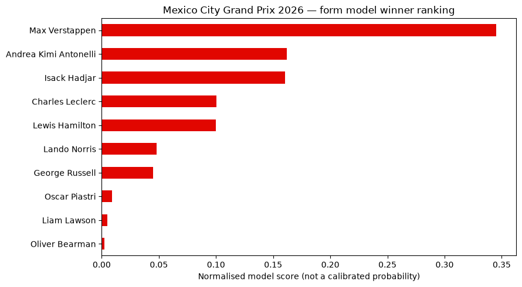
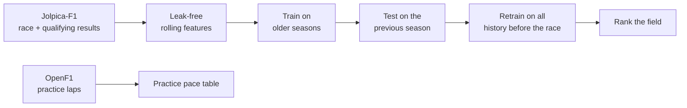

<div align="center">

# 🏎️ F1 Race Winner Predictor

**A machine-learning notebook that ranks the likely winner of any Formula 1 Grand Prix.
It updates itself through the race weekend: before practice, after practice, after qualifying and after the race.**

[](https://colab.research.google.com/github/DaenerysDrag/F1/blob/main/F1_Race_Winner_Predictor.ipynb)


</div>

---

## 🇲🇽 Next up: Mexico City Grand Prix, 1 November 2026

<p align="center">
  
</p>

| Rank | Driver | Team | Model score |
|:---:|---|---|:---:|
| 🥇 1 | Max Verstappen | Red Bull | 0.35 |
| 🥈 2 | Andrea Kimi Antonelli | Mercedes | 0.16 |
| 🥉 3 | Isack Hadjar | Red Bull | 0.16 |

<sub>Form model, pre-weekend · results through the 2026 United States GP (25 Oct) · entry list taken from the last race's grid.
This prediction will change after qualifying. Re-run the notebook to update it.</sub>

> Scores rank drivers by their chance of **winning**. They add up to 1 across the field but are **not calibrated
> probabilities**, and the ranking is not a predicted finishing order.

---

## 🔄 One notebook, four weekend stages

Each time it runs, the notebook downloads the newest data and checks how far the race weekend has got:

| When you run it | What it does |
|---|---|
| **Before the weekend** | Predicts with the **form model** (recent driver and team form, plus history at this track). |
| **After practice** | Adds a **practice pace table**: best lap, gap, and long-run pace with tyre compound for each driver. |
| **After qualifying** | Switches to the **qualifying model** and uses this weekend's qualifying line-up as the entry list. |
| **After the race** | Compares the prediction with the result: the top pick's finish, the winner's model rank, and the top 10 side by side. |

**No stale data:** finished seasons are cached because they never change. The **current season is downloaded
fresh on every run**, so a result published an hour ago is included. Results usually appear within a few hours of a session ending.

**Any race:** change one setting, `CIRCUIT_ID` (`rodriguez` = Mexico City, `interlagos` = São Paulo, `vegas`, `losail`,
`yas_marina`, `americas` = Austin…). If the code is wrong, the notebook lists the valid ones.

---

## ⚙️ How it works



Each input is calculated **only from races before the one being predicted**. A driver's rolling record is
updated *after* their row is written, so a race can never see its own result.

| Group | Inputs | Window |
|---|---|---|
| **Driver form** | Average finish · average points · win rate · podium rate · number of starts on record | Last 5 races |
| **Team form** | Combined team points · team win rate | Last 5 races |
| **Track history** | Average finish at this circuit · win rate at this circuit | Last 3 visits |
| **Qualifying** *(qualifying model only)* | Qualifying position this weekend | — |

Both models use the same `XGBClassifier` settings and are trained to answer *"did this driver win this race?"*.
Training data covers every Grand Prix since 2022. Sprint races are excluded, and 2022 is only used to fill the
rolling windows.

---

## 📊 Honest results

Both models were trained on 2023–2024 and tested on **all 24 races of 2025**, which they never saw during training.
They are compared with two simple rules.

| Approach | Winner picked | Hit rate | Winner in top 3 picks |
|---|:---:|:---:|:---:|
| Form model | 7 / 24 | 29.2% | 75.0% |
| Qualifying model | 12 / 24 | 50.0% | 100.0% |
| Rule: best recent average finish | 7 / 24 | 29.2% | 70.8% |
| **Rule: pole sitter wins** | **16 / 24** | **66.7%** | 95.8% |

What this shows:

- **Before qualifying**, the form model only matches the simple recent-form rule. Results alone mostly tell you
  "who has been finishing well lately".
- **Qualifying position is the strongest single signal.** Adding it lifts the model from 29% to 50%, and the
  winner was among its top three picks in every 2025 race.
- **The pole sitter still beat both models in 2025.** The models learned from 2023, when Verstappen won from
  anywhere on the grid, so they rely on form more than 2025 needed. After qualifying, the notebook prints the pole
  sitter next to the model's pick.

### Scorecard so far

| Race | Model's top pick | Winner | Winner's rank in model | Pole sitter |
|---|---|---|:---:|---|
| United States GP 2026 (Austin) | Max Verstappen (finished P3) | **Andrea Kimi Antonelli** | #2 | Antonelli ✅ |
| Mexico City GP 2026 | Max Verstappen *(pre-weekend)* | *1 Nov* | — | — |

---

## 🚀 Run it

**Google Colab (easiest):** click **Open in Colab** above, set `CIRCUIT_ID`, then choose **Runtime → Run all**.
Run it again after each session as the weekend goes on.

**Locally:**

```bash
git clone https://github.com/DaenerysDrag/F1.git
cd F1
pip install "fastf1==3.9.0" "xgboost==2.1.4" matplotlib requests jupyter
jupyter notebook F1_Race_Winner_Predictor.ipynb
```

> On macOS, XGBoost needs OpenMP: `brew install libomp`.

**Use an official entry list:** put an `entries.csv` next to the notebook with the columns
`driverId, constructorId, driver, team` (and optionally `quali_position`). It replaces the automatic line-up, which is
useful when a driver substitution is announced before qualifying.

### Data sources

| Source | Used for | Notes |
|---|---|---|
| [Jolpica-F1](https://github.com/jolpica/jolpica-f1) (Ergast successor), via FastF1 | Calendar, race results, qualifying results | Free, no key |
| [OpenF1](https://openf1.org) | Practice lap times, tyre stints, driver names | Free for completed sessions |

FastF1's own lap-timing feed now requires an F1 TV subscription, so practice data comes from OpenF1 instead.

---

## 📁 Repository structure

```
F1/
├── F1_Race_Winner_Predictor.ipynb     # The predictor: any race, any weekend stage
├── assets/
│   └── mexico-2026-ranking.png        # Latest prediction chart
├── archive/
│   └── Austin_GP_Winner_Predictor.ipynb   # First version (Austin only, form model only)
└── README.md
```

---

## 🛣️ Ideas for next steps

- Make the qualifying model beat the pole-sitter rule, for example with a "qualified on pole" input or training on more seasons.
- Add sprint results as form inputs on sprint weekends.
- Calibrate the scores so they can be read as real probabilities.
- Track the scorecard for every 2026 race automatically.

---

## 🙏 Credits

[FastF1](https://github.com/theOehrly/Fast-F1) · [Jolpica-F1](https://github.com/jolpica/jolpica-f1) ·
[OpenF1](https://openf1.org) · [XGBoost](https://xgboost.ai/) · [pandas](https://pandas.pydata.org/) ·
[matplotlib](https://matplotlib.org/)

<sub>This is an unofficial fan project. It is not affiliated with Formula 1, the FIA or any team. F1 and Formula 1 are
trademarks of Formula One Licensing B.V.</sub>
