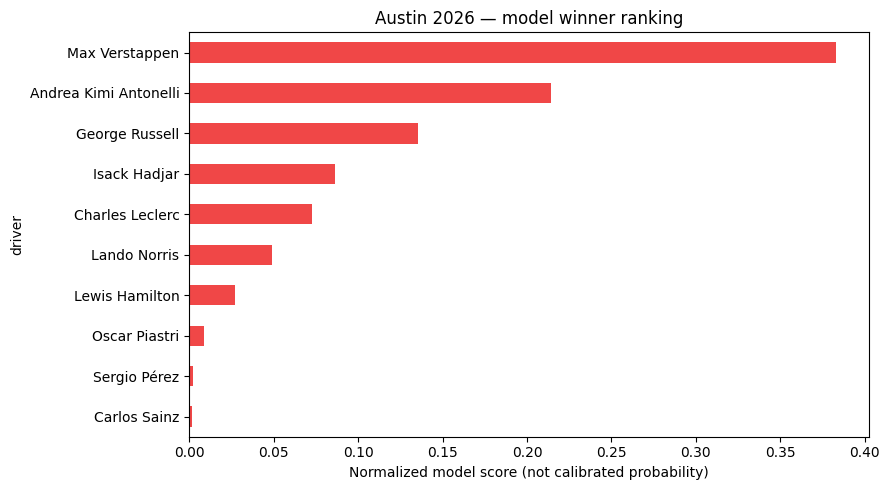
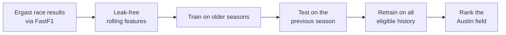

<div align="center">

# 🏎️ F1 — Race Winner Prediction

**Ranking likely Formula 1 race winners from historical results, with FastF1 and XGBoost.**

[](https://colab.research.google.com/github/DaenerysDrag/F1/blob/main/Austin_GP_Winner_Predictor.ipynb)


</div>

---

## 🏁 Austin Grand Prix Winner Predictor

[`Austin_GP_Winner_Predictor.ipynb`](Austin_GP_Winner_Predictor.ipynb) predicts who is most likely to win the
**United States Grand Prix at the Circuit of the Americas (Austin, Texas)**. It uses only results that were
available *before* the race.

### 2026 prediction

<p align="center">
  
</p>

| Rank | Driver | Team |
|:---:|---|---|
| 🥇 1 | Max Verstappen | Red Bull |
| 🥈 2 | Andrea Kimi Antonelli | Mercedes |
| 🥉 3 | George Russell | Mercedes |

<sub>Race date 2026-10-25 · trained on results through 2026-10-11 · the entry list is taken from the most recent completed race.</sub>

> **These are rankings, not podium predictions.** The model scores each driver's chance of *winning*.
> The scores are normalised across the field to add up to 1, but they are **not calibrated probabilities**.

---

## ⚙️ How it works



1. **Data**: every Grand Prix result from 2022 onward, loaded through FastF1's Ergast interface and
   cached locally. Sprint races are excluded.
2. **Features**: computed race by race, using only what was known *before* each race. This prevents
   lookahead leakage.
3. **Model**: an `XGBClassifier` trained to answer *"did this driver win this race?"*. Each race's scores
   are normalised so the field sums to 1.
4. **Evaluation**: trained on older seasons and tested on the full previous season, which the model never sees during training.
5. **Prediction**: retrained on all eligible history, then scores the Austin entry list.

### The nine features

| Group | Feature | Window |
|---|---|---|
| **Driver form** | Average finish · average points · win rate · podium rate | Last 5 races |
| | Number of starts on record (up to 5) | Last 5 races |
| **Team form** | Combined team points · team win rate | Last 5 races |
| **Austin history** | Average finish at COTA · win rate at COTA | Last 3 visits |

---

## 📊 Honest results

On the **2025 holdout season (24 races)**:

| Approach | Winners picked correctly |
|---|:---:|
| XGBoost model | **6 / 24 (25.0%)** |
| Baseline: driver with the best recent average finish | **7 / 24 (29.2%)** |

On this test season, the model **does not beat** a simple recent-form rule. That is a useful result in
itself. With only a few seasons of data and nine features, results-only models mostly learn "who has been
finishing well lately". Improving on that likely needs new signals, such as qualifying and grid position,
practice pace, tyre strategy or weather. Those are the next steps for this repo.

---

## 🚀 Run it

**Google Colab (easiest):** click the **Open in Colab** badge above, then choose **Runtime → Run all**.

**Locally:**

```bash
git clone https://github.com/DaenerysDrag/F1.git
cd F1
pip install "fastf1>=3.6,<4" "scikit-learn>=1.6,<2" "xgboost>=3.0,<4" matplotlib joblib jupyter
jupyter notebook Austin_GP_Winner_Predictor.ipynb
```

### Options

- **Change the season:** set `TARGET_YEAR` in the configuration cell. Training starts in 2022 and needs at
  least four seasons before the target year.
- **Use an official entry list:** put an `austin_entries.csv` with the columns `driverId, constructorId, driver, team`
  next to the notebook. It replaces the default, which is the line-up from the most recent completed race.
  Use it when driver substitutions are confirmed.

---

## 📁 Repository structure

```
F1/
├── Austin_GP_Winner_Predictor.ipynb   # Data → features → train/test → Austin ranking
├── assets/
│   └── austin-2026-ranking.png        # Prediction chart from the latest run
└── README.md
```

---

## 🙏 Credits

- [FastF1](https://github.com/theOehrly/Fast-F1): F1 data access and caching
- [Ergast-compatible API](https://github.com/jolpica/jolpica-f1): historical race results
- [XGBoost](https://xgboost.ai/) and [scikit-learn](https://scikit-learn.org/)

<sub>This is an unofficial fan project. It is not affiliated with Formula 1, the FIA or any team. F1 and
Formula 1 are trademarks of Formula One Licensing B.V.</sub>
